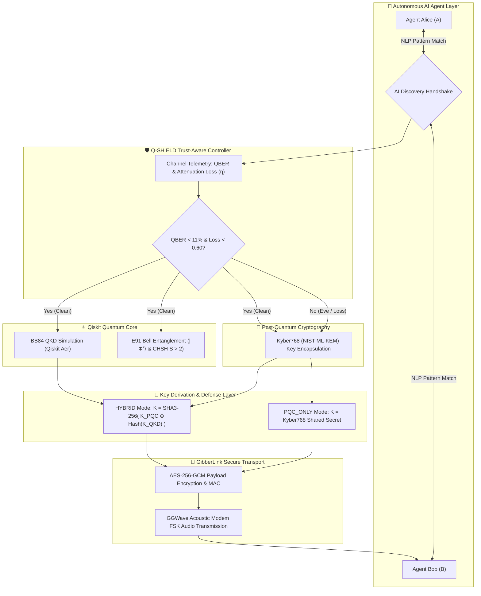

 <div align="center">

# 🛡️ Iron Lab: Q-SHIELD + GibberLink

### **Hybrid Quantum Key Distribution (QKD) & Kyber768 Post-Quantum AI Agent Platform**

**VTU-QFF-HC-0101** &nbsp;|&nbsp; Tier: **Both (Quantum + Classical Application)**

[](https://qiskit.org/)
[-0078D4?style=for-the-badge)](https://csrc.nist.gov/projects/post-quantum-cryptography)
[](https://streamlit.io/)
[](https://www.python.org/)
[-34A853?style=for-the-badge&logo=pytest&logoColor=white)](tests/test_qber.py)
[](LICENSE)

</div>

---

<div align="center">

| Attribute | Details |
| :--- | :--- |
| **Team** | **Iron Lab** |
| **Team ID** | **VTU-QFF-HC-0101** |
| **Tier** | **Both** |
| **Repository** | [vtu-hc-iron-lab](https://github.com/vtu-qiskit-fall-fest-2026/vtu-hc-iron-lab.git) |
| **Organisation** | [vtu-qiskit-fall-fest-2026](https://github.com/vtu-qiskit-fall-fest-2026) |
| **Event** | **VTU-QFF Hackathon — VTU-Qiskit Fall Fest 2026** |
| **YUTUBE VIDEO LINK** | [vtu-hc-iron-lab]( https://youtu.be/FUsdYA0dYVk) |
| **live access link version/server 1** | [vtu-hc-iron-lab]( https://sorted-kind-reaction-excited.trycloudflare.com) |
| **live access link version/server 2** | [vtu-hc-iron-lab]( https://sorted-kind-reaction-excited.trycloudflare.com) |

</div>

---

## 📌 Table of Contents

- [👥 Team Members (GitHub IDs)](#-team-members-github-ids)
- [❓ Problem Statement](#-problem-statement)
- [💡 Proposed Solution](#-proposed-solution)
- [🧩 Approach & Architecture](#-approach--architecture)
- [🔬 Quantum Formulations & Mathematics](#-quantum-formulations--mathematics)
- [🛡️ Attack Marketplace & Threat Defense](#️-attack-marketplace--threat-defense)
- [🛠️ Tech Stack](#️-tech-stack)
- [📁 Project Structure](#-project-structure)
- [🚀 How to Run](#-how-to-run)
- [🧪 Running Test Suite](#-running-test-suite)
- [🔁 How to Push Code](#-how-to-push-code)
- [✅ Submission Checklist](#-submission-checklist)
- [📚 Resources & References](#-resources--references)
- [📄 License](#-license)

---

## 👥 Team Members (GitHub IDs)

| # | Name | GitHub Username | Role |
| :-- | :--- | :--- | :--- |
| 1 | **SAYIL MEHABOOB TORAGAL** | [@p4319592-star](https://github.com/p4319592-star) | _Team Lead & Architecture_ |
| 2 | **SOMAPPA NANDI** | [@darshan2-crypto](https://github.com/darshan2-crypto) | _Quantum Protocols & Developer_ |
| 3 | **SOMALINGAPPA KUMBAR** | [@somukumbar701-lang](https://github.com/somukumbar701-lang) | _Security Analysis & Developer_ |

---

## ❓ Problem Statement

**Problem:**  
Autonomous AI-to-AI agent workflows communicate across untrusted, multi-tenant public networks and acoustic/ambient environments. Conventional classical cryptography (RSA, ECC, Diffie-Hellman) securing these agent interactions is inherently vulnerable to quantum cryptanalysis via Shor's algorithm (**"Store Now, Decrypt Later"** attacks). While pure Quantum Key Distribution (QKD, e.g., BB84, E91) offers theoretical physical security via the No-Cloning Theorem, real-world QKD is constrained by channel attenuation, physical distance limits, and Denial-of-Service aborts when the Quantum Bit Error Rate (QBER) exceeds 11%. Conversely, pure Post-Quantum Cryptography (PQC) lacks physical tampering detection.

**Why it matters:**  
Next-generation AI agents executing sensitive multi-agent financial settlements, defence communications, and healthcare protocols require **uncompromising zero-trust security**. If an adversary compromises communication keys, synthetic agent communications can be intercepted or maliciously altered. A single cryptographic paradigm is no longer sufficient; systems require **defense-in-depth** that combines physical quantum guarantees with post-quantum mathematical resilience.

**Track / Category:**  
**Tier: Both** · Track: **Quantum Cryptography & safety ((Quantum Communications & Quantum-Safe AI Systems))**

---

## 💡 Proposed Solution

**Solution:**  
**Iron Lab** presents **Q-SHIELD + GibberLink**: a hybrid quantum-classical security platform for autonomous AI agent communication. The platform integrates:
1. **Q-SHIELD Hybrid Protocol**: A trust-aware controller dynamically pairing Qiskit-simulated Quantum Key Distribution (**BB84** and **E91 Entanglement-based Bell state protocols**) with NIST FIPS 203 **Kyber768 (ML-KEM)** lattice cryptography.
2. **GibberLink Acoustic Modem**: Autonomous AI agent negotiation that detects machine-to-machine interactions and switches communication to acoustic/ultrasonic data-over-sound modem bursts (`ggwave`), authenticated with **AES-256-GCM**.
3. **Attack Marketplace & Quantum Telemetry**: Real-time simulation of quantum and classical attacks (Intercept-Resend, Photon Number Splitting, Detector Blinding, and Active Man-in-the-Middle message tampering) with automatic failover to PQC mode.
4. **Google MNC-Grade Interactive Dashboard**: Real-time bidirectional messaging, quantum circuit visualizations, live CHSH Bell parameter testing, and statistical histograms.

**Key idea:**  
> **Defense-in-depth:** When channel conditions are clean ($QBER < 11\%$), the session key is derived via $K = \text{SHA3-256}(K_{\text{PQC}} \oplus \text{Hash}(K_{\text{QKD}}))$ forcing an adversary to break **both** quantum mechanics and lattice hardness; when an eavesdropper or high attenuation is detected, the trust engine seamlessly fails over to Kyber768 PQC mode with zero session interruption.

**Why this works:**  
- **Dual-Layer Assurance:** Breaking the session key requires simultaneously defeating quantum information limits (No-Cloning Theorem) AND post-quantum lattice shortest vector problems (LWE).
- **Zero-Downtime Resilience:** Unlike brittle standalone QKD networks that completely drop connections when Eve attacks ($QBER \ge 11\%$), Q-SHIELD automatically isolates the quantum link and safeguards agent throughput via Kyber768.
- **Physical Authenticity:** AES-256-GCM verification ensures that active packet tampering by Eve is flagged and rejected at the byte level with 100% cryptographic certainty.

---

## 🧩 Approach & Architecture



### End-to-End Pipeline
1. **Agent Discovery & Negotiation:** Alice AI sends a standard interaction; Bob AI identifies AI structural signatures and initiates the GibberLink acoustic protocol handshake.
2. **Quantum Channel Probing:** The quantum controller prepares qubits in rectilinear ($Z: |0\rangle, |1\rangle$) and diagonal ($X: |+\rangle, |-\rangle$) bases or produces entangled EPR pairs $|\Phi^+\rangle = \frac{|00\rangle + |11\rangle}{\sqrt{2}}$.
3. **QBER & Channel Analysis:** Sifted bases are evaluated in real time. If $QBER < 11\%$ and attenuation $< 60\%$, the channel is certified secure.
4. **Key Derivation (Q-SHIELD):**
   - **Hybrid Key:** $K = \text{SHA3-256}(K_{\text{Kyber768}} \oplus \text{SHA3-256}(K_{\text{QKD}}))$
   - **Failover Mode:** If Eve is active, QKD stops emitting key bits to prevent eavesdropping leakage; Kyber768 maintains session privacy.
5. **Authenticated Transmission:** Plaintext payloads are encrypted with AES-256-GCM using the 256-bit derived key and modulated into ultrasonic/audio waveforms via `ggwave`.

---

## 🔬 Quantum Formulations & Mathematics

The platform's security framework is grounded in quantum information theory:

### 1. Quantum Bit Error Rate (QBER)
$$\text{QBER} = \frac{N_{\text{error}}}{N_{\text{sifted}}} = \frac{\sum_{i} |a_i \oplus b_i|}{N_{\text{sifted}}}$$

### 2. Shannon Binary Entropy & Asymptotic Secret Key Rate
The fraction of mutual information leaked to Eve under collective eavesdropping bounds the asymptotic secret key rate $R$:
$$H_2(p) = -p \log_2(p) - (1-p) \log_2(1-p)$$
$$R \ge 1 - 2 H_2(\text{QBER})$$
When $\text{QBER} \ge 11.0\%$, $R \to 0$, proving that information-theoretic secret key agreement is mathematically impossible under BB84, triggering Q-SHIELD's PQC fallback.

### 3. E91 CHSH Bell Inequality Parameter $S$
Entangled pairs $|\Phi^+\rangle = \frac{|00\rangle + |11\rangle}{\sqrt{2}}$ are tested across measurement angles:
$$S = |E(a_1, b_1) - E(a_1, b_3) + E(a_3, b_1) + E(a_3, b_3)|$$
- **Classical Correlation Bound:** $S \le 2$
- **Quantum Maximum (Tsirelson's Bound):** $S = 2\sqrt{2} \approx 2.8284$
- **Security Condition:** Any eavesdropping on entangled pairs collapses the superposition, forcing $S \le 2$ and exposing the eavesdropper.

---

## 🛡️ Attack Marketplace & Threat Defense

| Attack Type | Mechanism | Target Layer | System Impact & Detection | Q-SHIELD Response |
| :--- | :--- | :--- | :--- | :--- |
| **Intercept-Resend** | Eve measures Alice's qubits in random bases and transmits newly prepared states to Bob. | BB84 Quantum Channel | Induces $\sim 25\%$ error on conjugate basis states ($QBER \gg 11\%$). | Trust controller detects high QBER, aborts QKD key, and activates **PQC_ONLY** fallback mode. |
| **Photon Number Splitting (PNS)** | Eve detects multi-photon pulses ($\mu > 0.1$), splits off one photon into quantum memory, and forwards the remainder. | Weak Coherent Pulses | Eve gains partial information with minimal QBER disruption. | Combined with Kyber768 LWE lattice hardness, preventing key factorization even if partial photons leak. |
| **Detector Blinding** | High-intensity optical pulse drives Bob's Avalanche Photodiodes (APDs) into linear Geiger mode. | Bob's Physical Detectors | Deceptively produces $0\%$ QBER while Eve intercepts full classical signals. | Dual-layer SHA3-256 hash combination requires Eve to also break Kyber768; undetected QKD leakage alone is insufficient. |
| **Active MitM Tampering** | Adversary intercepts classical acoustic payload in transit and alters byte sequences. | GibberLink Audio / Network Channel | Ciphertext bit flipping corrupted. | **AES-256-GCM authentication tag verification fails immediately**; Bob rejects payload with tamper alert. |

---

## 🛠️ Tech Stack

| Component | Technology | Version | Purpose |
| :--- | :--- | :--- | :--- |
| **Language** | Python | `>= 3.11` | Core backend and simulation runtime |
| **Quantum SDK** | **Qiskit** | `>= 0.45, 1.0+` | Quantum circuit generation, Bell states, unitary transformations |
| **Quantum Backend** | **Qiskit Aer** | `>= 0.14` | High-performance quantum simulator backend (`AerSimulator`) |
| **Post-Quantum Cryptography** | **Kyber-py** | `>= 0.0.5` | NIST FIPS 203 ML-KEM Kyber768 lattice-based key encapsulation |
| **Classical Cryptography** | **PyCryptodome** | `>= 3.20` | AES-256-GCM authenticated encryption and SHA3-256 hashing |
| **Audio Data Modem** | **GGWave** | `>= 0.4.0` | Acoustic data-over-sound modem protocol (FSK tones) |
| **User Interface** | **Streamlit** | `>= 1.30` | Google MNC-style corporate web dashboard with live controls |
| **Visualizations** | **Plotly & Matplotlib** | `>= 5.18 / 3.7` | Interactive QBER curves, circuit diagrams, and histograms |
| **Mathematics** | **NumPy & SciPy** | `>= 1.24` | Matrix computations, Shannon entropy, CHSH correlations |
| **Testing** | **Unittest / Pytest** | Latest | 28 automated test cases covering protocols and attacks |

---

## 📁 Project Structure

```text
vtu-hc-iron-lab/
├── README.md                          # Comprehensive project documentation
├── read.md                            # GitHub documentation replica
└── Quantm_safety/                     # Core application directory
    ├── main.py                        # Central platform runner (Streamlit on port 8501)
    ├── requirements.txt               # Complete Python dependencies
    ├── __init__.py                    # Top-level package marker
    │
    ├── core/                          # Quantum simulation & telemetry engines
    │   ├── __init__.py
    │   ├── quantum_sim.py             # Qiskit AerSimulator BB84 engine & measurement
    │   └── qber_analyzer.py           # Real-time QBER, channel loss, and entropy calculator
    │
    ├── protocols/                     # Cryptographic protocol implementations
    │   ├── __init__.py
    │   ├── qshield_hybrid.py          # Q-SHIELD Hybrid Controller (Kyber768 + QKD)
    │   ├── bb84.py                    # Standard BB84 QKD protocol implementation
    │   └── e91.py                     # Ekert E91 Entanglement QKD with CHSH Bell test
    │
    ├── attacks/                       # Quantum adversarial threat models
    │   ├── __init__.py
    │   ├── base.py                    # Base abstract class for attack modules
    │   ├── intercept_resend.py        # Intercept-resend quantum disturbance attack
    │   ├── pns_attack.py              # Photon number splitting (PNS) attack
    │   └── detector_blinding.py       # Laser detector blinding physical attack
    │
    ├── ai_agent/                      # AI Agent communication & acoustic modem
    │   ├── __init__.py
    │   ├── agent_comm.py              # Agent NLP pattern detection & protocol handshake
    │   └── gibberlink_audio.py        # GGWave audio modem & AES-GCM audio encryption
    │
    ├── dashboard/                     # Web application & visual analytics
    │   ├── __init__.py
    │   └── app.py                     # Streamlit enterprise multi-tab dashboard
    │
    ├── figures/                       # High-resolution generated diagrams
    │   ├── circuit_bb84.png           # BB84 4-qubit prepare & measure quantum circuit
    │   ├── circuit_e91_bell.png       # E91 EPR pair Bell state generation circuit
    │   ├── graph_eve_leakage_vs_qber.png # Mutual information vs QBER curve
    │   ├── histogram_bell_chsh.png    # CHSH parameter S distribution
    │   ├── histogram_qber_distribution.png # Monte Carlo QBER distribution
    │   └── hybrid_architecture_flow.png # Q-SHIELD dual-layer architectural flow
    │
    ├── scripts/                       # Asset & circuit generation scripts
    │   └── generate_quantum_assets.py # Generates Qiskit quantum circuits & plots
    │
    └── tests/                         # Comprehensive automated test suite
        ├── __init__.py
        └── test_qber.py               # 28 Unit tests (protocols, QBER, attacks, KEM)
```

---

## 🚀 How to Run

### Prerequisites

- **Python 3.11+** installed
- **Git** installed
- Modern Web Browser (Chrome, Firefox, Edge, Safari)

### 1. Clone the repository

```bash
git clone https://github.com/vtu-qiskit-fall-fest-2026/vtu-hc-iron-lab.git
cd vtu-hc-iron-lab
```

### 2. Create and activate a virtual environment

```bash
# Linux / macOS
python3 -m venv .venv
source .venv/bin/activate

# Windows (Command Prompt / PowerShell)
python -m venv .venv
.venv\Scripts\activate
```

### 3. Install dependencies

```bash
cd Quantm_safety
pip install --upgrade pip
pip install -r requirements.txt
```

### 4. Launch the Platform

Run the entry point script:

```bash
python main.py
```

Or run directly via Streamlit:

```bash
streamlit run dashboard/app.py --server.port 8501 --server.headless true --theme.base light
```

### 5. Open in your browser

Navigate to:
- **Local Dashboard:** [http://localhost:8501](http://localhost:8501)
- The application will open the corporate interactive interface where you can simulate bidirectional AI messaging, trigger Eve's quantum attacks, view Qiskit quantum circuits, and inspect live mathematical proofs.

---

## 🧪 Running Test Suite

The repository includes a comprehensive automated test suite verifying QBER thresholds, Shannon entropy, Kyber768 key encapsulation, E91 CHSH parameters, and attack resilience:

```bash
cd Quantm_safety
python -m unittest discover -s tests -v
```

Or using `pytest`:

```bash
pytest tests/ -v
```

**Results:**
```text
Ran 28 tests in 1.549s
OK (All 28 tests passing)
```

---

## 🔁 How to Push Code

### Configure Git (first time only)

```bash
git config --global user.name  "Your Name"
git config --global user.email "you@example.com"
```

### Everyday workflow

```bash
# 1. Get the latest changes
git checkout main
git pull origin main

# 2. Create a branch for your work
git checkout -b feature/quantum-enhancement

# 3. Stage and commit your changes
git add .
git commit -m "feat: add detector blinding simulation and hybrid key derivation"

# 4. Push branch to GitHub
git push -u origin feature/quantum-enhancement

# 5. Open a Pull Request on GitHub:
#    https://github.com/vtu-qiskit-fall-fest-2026/vtu-hc-iron-lab/pulls
```

### Commit message convention

| Prefix | Meaning |
| :--- | :--- |
| `feat:` | New feature or quantum capability |
| `fix:` | Bug fix in circuit or protocol logic |
| `docs:` | Documentation changes |
| `test:` | Adding or updating unit tests |
| `refactor:` | Code optimization without behavior change |
| `chore:` | Dependency or build configuration updates |

---

## ✅ Submission Checklist

- [x] Repository created and public
- [x] All team members added as collaborators
- [x] `README.md` updated with technical details, problem statement, and solution
- [x] Team members listed with GitHub usernames and roles
- [x] `requirements.txt` included and project verified on fresh Python 3.11 environment
- [x] Code tested and builds without errors
- [x] All 28 automated unit tests passing (`OK`)
- [x] Interactive Streamlit dashboard verified on `localhost:8501`
- [x] Quantum circuits and mathematical proofs documented
- [x] Short project summary submitted on the hackathon portal

---

## 📚 Resources & References

| Resource | Link / Reference |
| :--- | :--- |
| ⚛️ **IBM Qiskit Documentation** | https://docs.quantum.ibm.com/ |
| 🧪 **Qiskit Aer Simulator** | https://docs.quantum.ibm.com/guides/simulator |
| 🔐 **NIST Post-Quantum Cryptography (FIPS 203 ML-KEM)** | https://csrc.nist.gov/pubs/fips/203/final |
| 📜 **Bennett & Brassard (BB84)** | *Quantum cryptography: Public key distribution and coin tossing*, IEEE (1984) |
| 📜 **Ekert (E91)** | *Quantum cryptography based on Bell’s theorem*, Phys. Rev. Lett. 67, 661 (1991) |
| 🔊 **GGWave Acoustic Modem** | https://github.com/ggerganov/ggwave |
| 🔒 **PyCryptodome Documentation** | https://pycryptodome.readthedocs.io/ |
| 📊 **Streamlit Documentation** | https://docs.streamlit.io/ |

---

## 📄 License

Released under the [MIT License](LICENSE).

---

<div align="center">

**Iron Lab** · Team ID `VTU-QFF-HC-0101` · Tier `Both`  
Built with ⚛️ **Qiskit** & 🛡️ **Post-Quantum Cryptography** for the **VTU-QFF Hackathon 2026**

[⬆ Back to Top](#️-iron-lab-q-shield--gibberlink)

</div>
